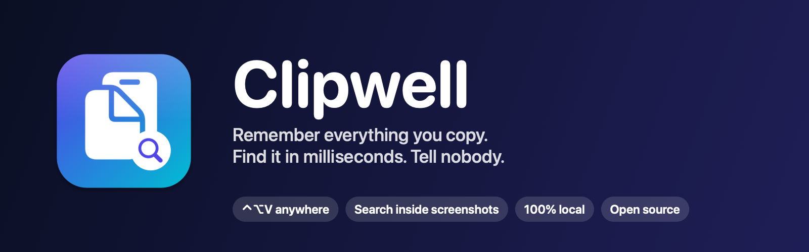
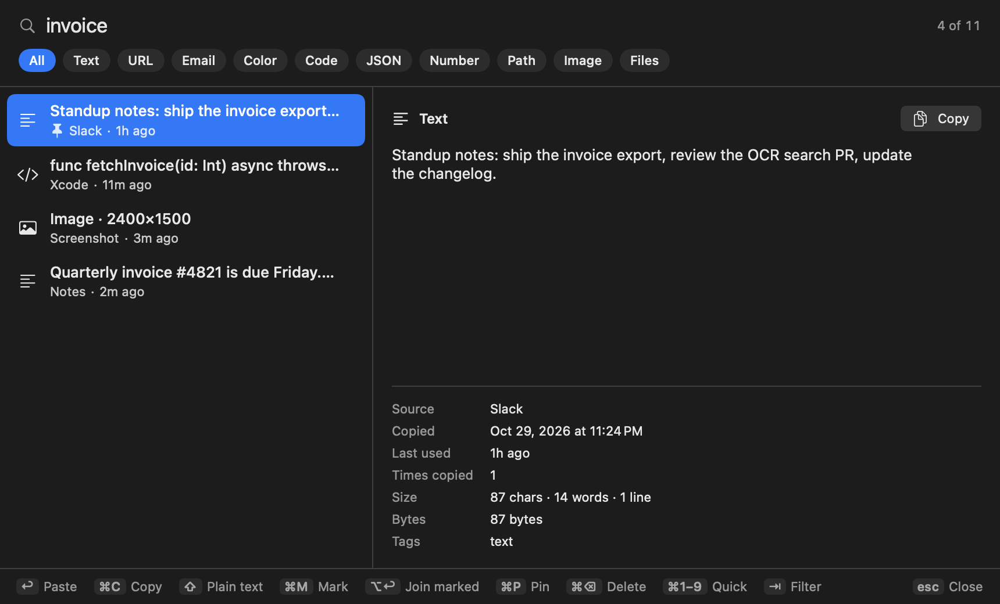

# Clipwell

<p align="center">
  
</p>

[](https://github.com/naveenrenji/Clipwell/actions/workflows/ci.yml)
[](LICENSE)


**The clipboard manager that remembers everything you copy, finds it again in milliseconds, and tells nobody.**

A free, open-source, native macOS menu-bar app. Press **⌃⌥V** anywhere, type a few letters, and paste or copy back anything you copied before: text, links, code, files and images, including words that only appear *inside* a screenshot.

<p align="center">
  
</p>
<p align="center"><em>Searching “invoice” finds the note, the code and a screenshot whose text was recognised on your Mac. (Made-up demo data.)</em></p>

Created by [Naveen Mathews Renji](https://github.com/naveenrenji). Requires macOS 14 or later. Building from source needs the Swift toolchain (Xcode, or the Command Line Tools via `xcode-select --install`).

## Why it stands out

Most clipboard tools make you pick two of *fast*, *private* and *thorough*. Clipwell is designed to be all three, and every claim below can be checked in the code or reproduced with the scripts in this repo.

| What you get | How it is done |
|---|---|
| **Search that reaches inside screenshots** | On-device Apple Vision OCR indexes every copied image, so "invoice" finds the screenshot of the invoice. Nothing is uploaded. |
| **Nothing leaves your Mac** | The source contains no network code (no URLSession, sockets or analytics to find). No account, no sync service, no telemetry. |
| **Built to keep secrets** | Copies flagged concealed by password managers are never recorded. API keys, tokens and private keys are masked, hidden in previews, and deleted after an hour unless pinned. Any app can be excluded in one click. Data files are owner-only. |
| **Fast enough to disappear** | Measured on 10,000 items (`./Scripts/bench.sh`): 0.2 ms to store a copy, 0.5 ms to list recent items, about 16 ms to search a very common word, 33 MB of memory. Classification, hashing, image encoding and OCR never touch the UI thread. |
| **Compact on disk** | Text is stored once (the search index points at it). Large photos and retina screenshots are stored as HEIC; small or transparent images stay lossless. Image storage has a size cap. Deleted items give their space back. |
| **Never loses your history** | Every write is synced to disk, backups are taken daily, and a damaged database is set aside (not deleted) and restored from the latest backup. |
| **Paste *or* copy, one item or many** | ↩ pastes, ⌘C copies back without pasting, ⇧ makes it plain text, ⌘M marks several items to paste or copy together, ⌘1–9 pastes the top nine, and the menu bar's *Copy Again* lists your latest ten. |
| **Opens where you are typing** | The window appears at your text caret (via Accessibility), is resizable, and remembers its size. |
| **Organised for review** | Every item carries its kind, source app, first copied, last used, times copied, size and tags (kind, domain, file extension, multiline, ocr, sensitive). Filter by kind with one key. |
| **Tested, not hoped** | 89 automated checks cover the classifier, search, retention, backups, restarts, data migration and the image codec; a benchmark script gives you timings on your own machine; CI builds every commit. |
| **Small and readable** | About 2,200 lines of Swift, no dependencies, MIT licensed. You build it yourself, so you can read exactly what runs. |

It exists because the usual complaints about clipboard managers are real: lost history after a restart, weak search, no way to paste several items, secrets quietly recorded, and conflicts with remote-desktop apps. Each of those is addressed above (and ⌘V is deliberately not sent into remote-desktop and VM apps). Apple's built-in clipboard history is intentionally basic; reports on macOS 27 say it still lacks pinning and per-app exclusions ([source](https://dev.to/jrw0ng/macos-tahoe-has-built-in-clipboard-history-heres-what-its-still-missing-for-developers-2026-4eko)).

### Where it stands

Clipwell is young. [Maccy](https://maccy.app/) is a mature, popular open-source alternative and [ClipVault](https://eddmann.com/ClipVault) offers encryption at rest, which Clipwell does not have yet. What Clipwell adds is the combination above: screenshot search, secret expiry, multi-item paste, daily backups and caret-aware placement. Not here yet: encryption at rest, notarized downloads and sync across devices (sync is omitted on purpose, to keep everything local). See the [roadmap](ROADMAP.md).

## Download

Get the latest universal build (Apple silicon and Intel) from the **[Releases page](https://github.com/naveenrenji/Clipwell/releases/latest)**: download `Clipwell-<version>.zip`, unzip it and drag **Clipwell.app** to your Applications folder.

- **First launch.** Until releases are notarized by Apple, macOS asks you to approve the app once: open System Settings → Privacy & Security and click **Open Anyway**. Verify the download first with `shasum -a 256 -c Clipwell-<version>.zip.sha256`.
- **Homebrew** (once the tap is published, see [docs/RELEASING.md](docs/RELEASING.md)): `brew install --cask naveenrenji/clipwell/clipwell`.
- Prefer to read what you run? Build it yourself below; it takes under a minute.

## Install from source

```bash
git clone https://github.com/naveenrenji/Clipwell.git
cd Clipwell
./Scripts/bundle.sh
```

This builds a release binary and installs **`~/Applications/Clipwell.app`**, then you launch it:

```bash
open ~/Applications/Clipwell.app
```

Then, once:
1. Menu bar icon → **Open at Login** to start it automatically.
2. System Settings → Privacy & Security → **Accessibility** → enable Clipwell. This lets it press ⌘V for you and find your text caret. Without it everything still works; you just press ⌘V yourself and the window opens under the mouse.

Using your own app identifier (recommended for forks): `BUNDLE_ID=com.example.Clipwell ./Scripts/bundle.sh`.

## Use

Press **⌃⌥V** anywhere. The window opens next to your text caret when the app exposes it, otherwise near the top of the screen. Drag its edges to resize; the size is remembered.

| Key | Action |
|---|---|
| type | Search text, links, domains, source app, tags and text inside screenshots |
| ↑ ↓ | Move selection |
| ↩ | **Paste** the selected item into the app you came from |
| ⌘C | **Copy** the item back to the clipboard without pasting (the menu-bar icon flashes a check) |
| ⇧ with ↩ or ⌘C | Plain text only |
| ⌘M | Mark items for a multi-item paste (numbered in the order you mark them) |
| ↩ / ⌥↩ with marks | Paste or copy all marked items joined by newlines / spaces |
| ⌘1 – ⌘9 | Paste the 1st – 9th item directly |
| ⌘P | Pin / unpin (pinned items never expire) |
| ⌘⌫ | Delete |
| ⇥ | Cycle the kind filter (text, URL, email, colour, code, JSON, number, path, image, files) |
| esc | Clear search, then clear marks, then close |

Mouse: double-click pastes; right-click for Paste, Copy, Copy as Plain Text, Pin and Delete; the **Copy** button in the preview does the same as ⌘C.

**Menu bar → Copy Again** lists your ten latest copies; one click puts one back on the clipboard.

## What it keeps

Text, URLs (including bare `github.com/x`), emails, colours, code, JSON, numbers, file paths, images and files. For each item: kind, source app, first copied, last used, times copied, characters, words, lines, bytes and tags. Copying the same thing again moves it to the top instead of adding a duplicate.

## Privacy and security

- Ignores copies flagged *concealed* or *transient* (the convention password managers follow) and anything copied in Keychain Access, Passwords, 1Password, Bitwarden or LastPass.
- **Menu bar → Stop Recording Copies From <app>** excludes any other app; it is listed under Excluded Apps so you can undo it.
- Values that look like API keys, tokens or private keys are tagged `sensitive`, masked until you press Reveal, and **deleted after 1 hour** unless pinned (change under *Delete Secrets After*). Screenshots whose text contains such a value are hidden the same way.
- The data folder `~/Library/Application Support/Clipwell/` is owner-only (directories 0700, files 0600). It is not encrypted beyond FileVault.
- Screenshot text recognition uses Apple's on-device Vision framework.
- Hardened-runtime, ad-hoc-signed build with no entitlements. You build it yourself, so you can read every line.

Report vulnerabilities privately; see [SECURITY.md](SECURITY.md).

## Storage and speed

- Text is stored once; the search index points at it instead of copying it.
- Classification, hashing, image encoding and OCR run off the main thread.
- Large opaque images are stored as HEIC (small or transparent ones stay lossless PNG); previews decode downscaled thumbnails straight from disk. Pasting always puts a PNG back on the clipboard.
- Limits are adjustable in the menu: 500–10,000 items and 250 MB–2 GB of images, oldest unpinned first. Deleted rows return their disk space.
- Numbers on your own machine: `./Scripts/bench.sh 10000` (uses a throwaway database).

## Reliability

Writes are synced to disk, the write-ahead log is folded in on quit, and a consistent daily backup is kept (last three in `backups/`). On launch a quick integrity check runs; a damaged database is renamed aside, never deleted, and the newest backup is restored.

## Remote desktop, VMs and screen sharing

⌘V is not sent into Microsoft Remote Desktop, VMware Fusion, Parallels, TeamViewer, AnyDesk, Screen Sharing or UTM (it would paste on the wrong side of the connection). The item is copied; press ⌘V yourself.

## How it works

```
Sources/Clipwell/
  main.swift          app entry (menu-bar agent, owner-only umask)
  AppDelegate.swift   wiring: capture → store, pasteboard writes, menu bar, upkeep timer
  Monitor.swift       pasteboard watcher (change-count poll, privacy filters)
  Classifier.swift    kind detection, tags, secret detection (pure functions)
  Store.swift         SQLite + FTS5: items, search, retention, backups, recovery
  Support.swift       hashing, formatting, image codec and preview cache
  OCR.swift           on-device text recognition for images
  HistoryPanel.swift  window controller, key handling, view model
  HistoryViews.swift  SwiftUI list, preview and footer
  Caret.swift         finds the text caret through Accessibility
  Paster.swift        ⌘V injection and the global hotkey
  Settings.swift      user-adjustable limits and app lists
Tests/                self-test and benchmark (no Xcode or XCTest needed)
Scripts/              bundle.sh (build, install, universal, sign), test.sh, bench.sh,
                      make-assets.swift (icon and banner), setup-github.sh (maintainer setup)
docs/                 RELEASING.md, banner and social preview images
packaging/homebrew/   cask template for a Homebrew tap
.github/              CI, release workflow, issue and PR templates, dependabot
```

## Contributing

Contributions are very welcome, and the codebase is small enough to read in an afternoon. Start with [CONTRIBUTING.md](CONTRIBUTING.md) and the [roadmap](ROADMAP.md); a misclassified copy is a great first issue. Please keep the app local-only and add a test for behaviour changes. Everyone participating is expected to follow the [code of conduct](CODE_OF_CONDUCT.md).

```bash
./Scripts/test.sh     # classifier, store, search, retention, backups, migration, image codec
./Scripts/bench.sh    # synthetic ingest and search timings
swift build           # debug build
```

## Known limitations

- Hex-like words such as `#bad` are classified as colours (they are valid CSS colours).
- Some apps (Electron apps, terminals) do not expose their caret, so the window falls back to the mouse position.
- Not notarized: macOS may ask you to approve it the first time if you copy a built app from another Mac. Building locally avoids this.
- No sync across devices, by design.

## License

[MIT](LICENSE) © 2026 Naveen Mathews Renji
